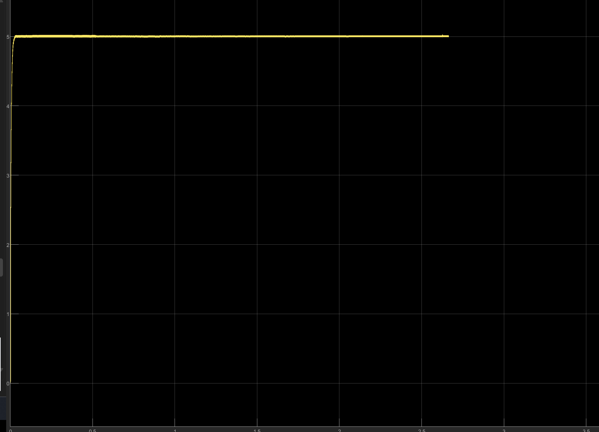
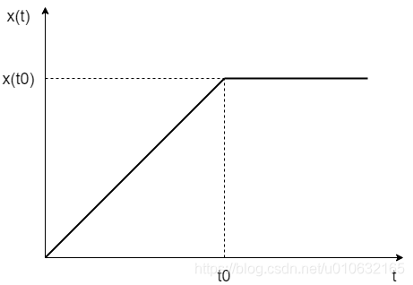
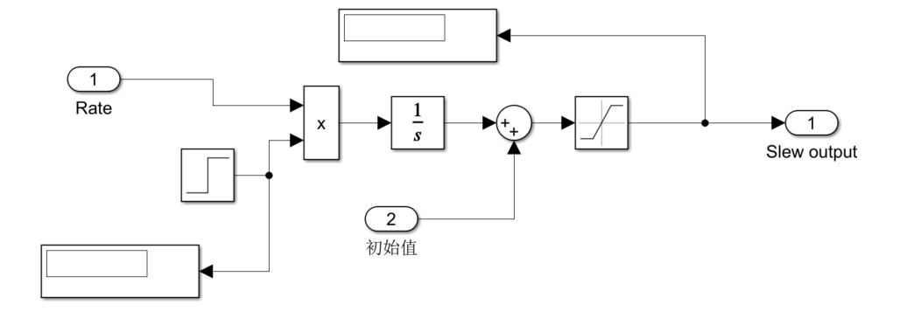
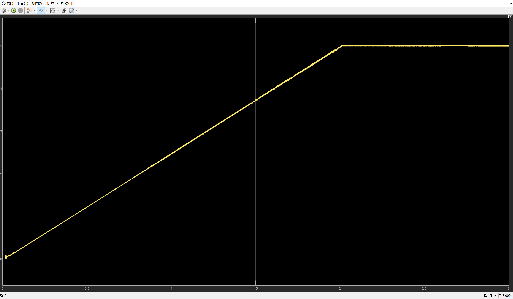
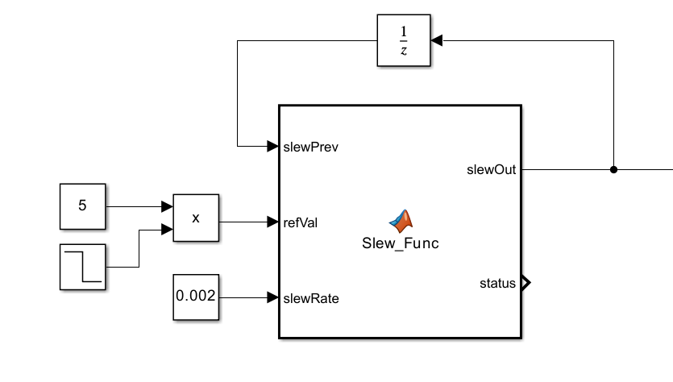
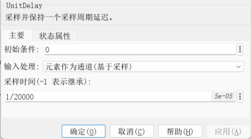
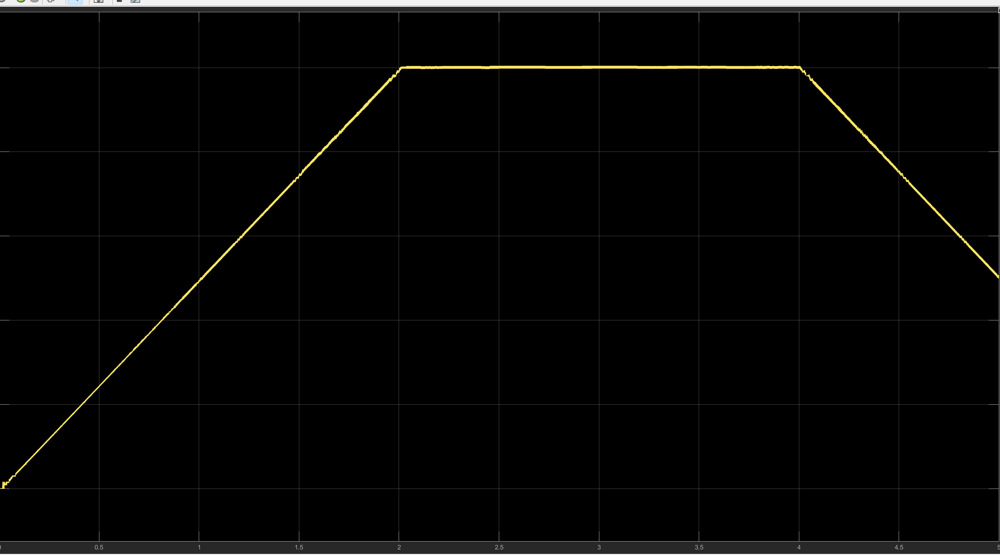

# 斜坡软启动软件保护设计说明

本文会介绍一种软启动算法，并进行演示，演示示例为三相交错Buck。

## 1. 软启动概述与斜坡软启动原理

### 1.1 什么是软启动

软启动（也称软起动或缓启动）是指系统从停止状态进入运行状态时，通过控制启动过程中的给定值或控制量，使系统逐步达到预定工作状态的一种控制方法。其目的是减轻启动瞬间的电气或机械冲击，使启动过程更加平稳、可控。本文统一使用“软启动”这一名称。

在电力电子控制系统中，软启动通常通过逐步调整电压参考值、电流参考值或占空比指令来实现。例如，电源启动时，可让电压参考值从初始值逐步增加至额定值，由控制环路调节实际输出跟随参考值变化。软启动直接约束的是给定值或控制量，实际输出的变化还受控制环路、负载和功率级特性的影响。

软件软启动的基本过程包括：启动前初始化软启动变量；满足启动条件后，按照设定规律更新给定值；给定值达到目标后，保持目标值并进入正常运行阶段。如果启动过程中出现故障，则由故障处理逻辑中断启动过程。



可以看到此时上电，就是一个阶跃信号，阶跃信号对环路要求相对比较高， 在大电流情况下，有可能会有冲激，造成管子或者负载的损坏。所以我们需要进行软启动。

### 1.2 斜坡软启动的原理及意义

软起动有很多种，除线性斜坡外，也可以采用 S 形曲线或分段变化等方式安排启动过程。线性斜坡软启动采用固定变化速率调整给定值，具有算法简单、参数含义明确、启动时间便于计算等特点，适合在周期执行的软件控制任务中实现。本文采用的 `Slew_Func` 函数通过限制每次调用的最大变化量，实现离散斜坡输出。

斜坡软启动是指系统启动时，不直接将控制给定值设置为最终目标值，而是使其从初始值开始，按照规定的变化速率逐步接近目标值。常见的处理对象包括电压参考值、电流参考值、转速参考值和占空比指令等。



例如，电源启动时，若电压参考值由 0 突然跳变为额定值，控制器可能因较大的瞬时误差输出较高的控制量，引起启动电流增大及输出电压超调。采用斜坡软启动后，参考值逐步上升，使系统以较平缓的方式进入正常运行状态。

斜坡软启动主要具有以下作用：

- 限制给定值的变化速度，减轻启动过程中的电流冲击和器件应力。
- 减小参考值突变对闭环控制系统的扰动，有助于降低超调。
- 通过设定斜坡速率调整启动时间，使启动过程可控。
- 在运行过程中平滑处理目标值变化，也可用于正常停机时的缓降。

软启动属于启动过程管理措施，不能替代过流、过压等故障保护。发生需要立即停机的故障时，应由故障处理逻辑直接执行关断，不能等待斜坡缓降完成。参考值平滑也不意味着实际电流一定不超限，其效果仍取决于控制环路、负载和限流策略。

## 2. 斜坡软启动的实现方法

在离散控制系统中，可通过限制每个控制周期内给定值的变化量，实现斜坡软启动。

设：

- $r[k]$：当前目标值。
- $y[k-1]$：上一周期的斜坡输出。
- $\Delta$：每次调用允许的最大变化量，要求 $\Delta>0$。
- $T_s$：函数调用周期，单位为秒。

首先计算偏差：

$$
e[k]=r[k]-y[k-1]
$$

再按照下式更新输出：

$$
y[k]=\begin{cases}
y[k-1]+\Delta, & e[k]\geq\Delta \\
y[k-1]-\Delta, & e[k]\leq-\Delta \\
r[k], & |e[k]|<\Delta
\end{cases}
$$

当偏差较大时，输出以固定步长增大或减小；当偏差小于一个步长时，直接将输出设置为目标值，避免在目标值附近来回跨越。

每次变化量与实际斜坡速率的关系为：

$$
\Delta=R T_s
$$

其中，$R$ 为单位时间内的变化速率。例如，电压参考值的 $R$ 单位为 V/s，而 $\Delta$ 的单位为 V。

对于固定目标值，从初始值 $y_0$ 到目标值 $r$ 所需的更新次数为：

$$
N=\left\lceil\frac{|r-y_0|}{\Delta}\right\rceil
$$

若首次更新发生在启动后的一个控制周期，则启动时间为 $NT_s$；具体波形的时间标记还与首次调用时刻有关。

例如，电压参考值需要在约 2 s 内从 0 V 上升至 5V，函数每 5e-5 s 调用一次，则：

$$
R=\frac{5}{2}=2.5\ \mathrm{V/s}
$$

$$
\Delta=2.5\times0.00005=0.000125\ \mathrm{V}
$$

即每次调用将参考值最多增加 0.000125 V。

## 3. C 语言斜坡函数及使用方法

### 3.1 函数代码

```c
float Slew_Func(float *slewVal, float refVal, float slewRate)
{
    static float diff = 0;
    diff = refVal - *slewVal;

    if (diff >= slewRate) {
        *slewVal += slewRate;
        return (1);
    } else if (-diff >= slewRate) {
        *slewVal -= slewRate;
        return (-1);
    } else {
        *slewVal = refVal;
        return (0);
    }
}
```

该函数通过指针修改斜坡输出，同时返回本次执行的分支状态。

### 3.2 参数及返回值

| 参数或返回值 | 含义 |
|---|---|
| `slewVal` | 指向当前斜坡输出的有效指针，函数执行后更新其指向的变量 |
| `refVal` | 最终希望达到的目标值 |
| `slewRate` | 每次调用允许的最大变化量，即 $\Delta$，必须大于零 |
| 返回 `1` | 本次执行了增加一个步长的分支 |
| 返回 `-1` | 本次执行了减少一个步长的分支 |
| 返回 `0` | 本次将输出直接设置为目标值 |

**`slewRate` 在这段代码中是每次调用的步长，不是每秒变化速率。** 函数调用周期改变时，若不重新计算该参数，实际启动时间也会改变。以下说明假定所有数值输入均为有限有效值。返回值用来查看软启动状态。

### 3.3 调用示例

以 0～5 V、启动时间约 2 s 为例：

```c
/* 在启动初始化时设置，后续调用之间必须保留该变量 */
static float voltageRefSoft = 0.0f;

/* 每 1 ms 执行一次 */
void Control_Task(void)
{
    const float targetVoltage = 5.0f;
    const float slewStep = 0.000125f;

    Slew_Func(&voltageRefSoft, targetVoltage, slewStep);

    /*
     * 将 voltageRefSoft 作为电压控制环的参考值。
     * 控制器使用 voltageRefSoft 与实际采样电压计算误差。
     */
}
```

调用后，`voltageRefSoft` 按照以下规律变化：

```text
0 → 0.000125 → 0.000250 → 0.000375 → …… → 5.000000
```

如果目标值随后降低，函数会使用相同的步长逐步减小输出，因此它同时具备上升和下降限速功能。

### 3.4 使用注意事项

1. **输出变量需要跨周期保存。** 不应在每次调用前都将 `voltageRefSoft` 重新赋值为零，否则无法形成连续累加的斜坡。
2. **步长必须大于零。** 步长为零时输出不能向不同的目标值移动；步长为负数时判断及更新方向不再符合设计意图。
3. **返回值不是严格的“未完成/已完成”标志。** 当偏差恰好等于一个步长时，本次输出已经到达目标值，但返回值仍为 `1` 或 `-1`。若目标保持不变，下一次调用才返回 `0`。
4. **`diff` 无须声明为 `static`。** 它每次调用都会重新计算，可改为局部变量 `float diff = refVal - *slewVal;`，避免共享临时变量带来的重入问题。真正需要保存的是 `*slewVal`。
5. **重新启动时应明确初始值。** 若要求每次从零启动，应在启动初始化阶段清零；若要求从当前工作点平滑接续，应使用相应的当前参考值初始化。

## 4. 在 Simulink 中采用基础模块搭建

其实用simulink的sps库也可以做出相同效果的模块。

### 4.1 参考图结构



图示可辨认为“斜坡速率与启动信号相乘—积分—初值叠加—限幅”的基本结构。由于图片分辨率较低，求和端口的符号和具体限幅值无法完全确认，以下按从初始值上升到目标值的常用形式说明。

```text
斜坡速率 R ──┐
             × ── 积分器 ── 求和 ── 限幅 ── 软启动输出
启动信号 ────┘                ↑
                           初始值 y0
```

其数学表达式为：

$$
y(t)=\operatorname{sat}\left(y_0+\int_0^t R\,u_{\mathrm{start}}(\tau)\,\mathrm{d}\tau\right)
$$

其中，启动信号在启动前为 0，启动后为 1；`sat` 表示限幅运算。

### 4.2 模块配置

以 0 V 上升至 5 V 为例，可按下表配置模块：

| 模块 | 用途 | 示例设置 |
|---|---|---|
| Rate | 设置斜坡速率 | `Rate`，单位 V/s |
| Step | 产生启动信号 | 跳变前为 `0`，跳变后为 `1`，跳变时刻为期望启动时刻 |
| Product | 控制斜坡是否累加 | 将速率与启动信号相乘 |
| Integrator | 对速率积分得到增量 | 初始条件为 `0` |
| 初始值 | 提供启动初始值 | `0`，单位 V |
| Sum | 将初始值与积分增量相加 | 设置为 `++` |
| Saturation | 将输出限制在目标范围 | 下限 `0`，上限 `5` |
| Scope / Outport | 显示或输出软启动参考值 | 连接限幅后的信号 |

启动前，积分器输入为零，输出参考值保持在初始值。启动后，积分器输入为 2.5 V/s，参考值线性上升，约 2 s 后达到 5 V，并由限幅模块限制在 5 V。

该结构用于固定目标的单次上升较直观，但需注意：

- 外部 Saturation 仅限制输出，积分器内部可能继续累积。需要重复启停时，应设置积分状态限幅或到达目标后停止积分，并提供复位逻辑。
- 启动信号变为零只会停止累加，不会自动使输出回零。
- 简单的固定速率积分结构不具备原 C 函数那样的任意目标双向跟踪能力。



## 5. 使用 MATLAB Function 实现原函数效果

### 5.1 实现思路

为对应 C 语言中的指针更新，将上一周期输出作为 MATLAB Function 的输入，并将更新后的输出通过 Unit Delay 反馈。这种方式便于设置初始值，也能直接观察保存的状态。

### 5.2 MATLAB Function 代码

在 MATLAB Function 模块中输入：

```matlab
function [slewOut, status] = Slew_Func(slewPrev, refVal, slewRate)
%#codegen
% slewPrev：上一周期的斜坡输出
% refVal：目标值
% slewRate：每次调用的最大变化量，必须大于 0
% slewOut：更新后的斜坡输出
% status：软启动当前状态
% 数值输入采用 single 类型，并应为有限有效值。

diff = refVal - slewPrev;

if diff >= slewRate
    slewOut = slewPrev + slewRate;
    status = single(1);
elseif -diff >= slewRate
    slewOut = slewPrev - slewRate;
    status = single(-1);
else
    slewOut = refVal;
    status = single(0);
end
end
```

### 5.3 模块连接及设置



具体设置步骤为：

1. 放置一个 MATLAB Function 模块，粘贴上述代码。
2. 使用 Constant 或 Step 模块提供目标值 `refVal`，例如 `single(5)`。
3. 使用 Constant 模块提供步长 `slewRate`，例如 `single(0.000125)`。
4. 将 `slewOut` 接入 Unit Delay，再将 Unit Delay 输出连接至 `slewPrev`。
5. 将 Unit Delay 的初始条件设置为 `single(0)`，采样时间设置为 `0.00005` s。
6. 将三个数值输入设置为 `single`，对应 C 语言的 `float`；`status` 也采用 `single`，保持原接口的浮点返回类型。
7. 在纯离散示例模型中采用固定步长、离散求解器，步长设置为 `0.001` s，并确认 MATLAB Function 按该周期执行。
8. 将 `refVal` 和 `slewOut` 接入 Scope，观察目标值与软启动输出的区别。可将 `status` 接入另一个 Scope 观察分支状态。

这里，Unit Delay 对应 C 程序中跨调用保存的 `voltageRefSoft`；MATLAB Function 的 `slewOut` 对应 C 函数更新后的 `*slewVal`；`status` 对应 C 函数返回值。



`unit delay`配置的采样时间配置为Ts。

可以来验证一下效果，0s开启，4s关断。




