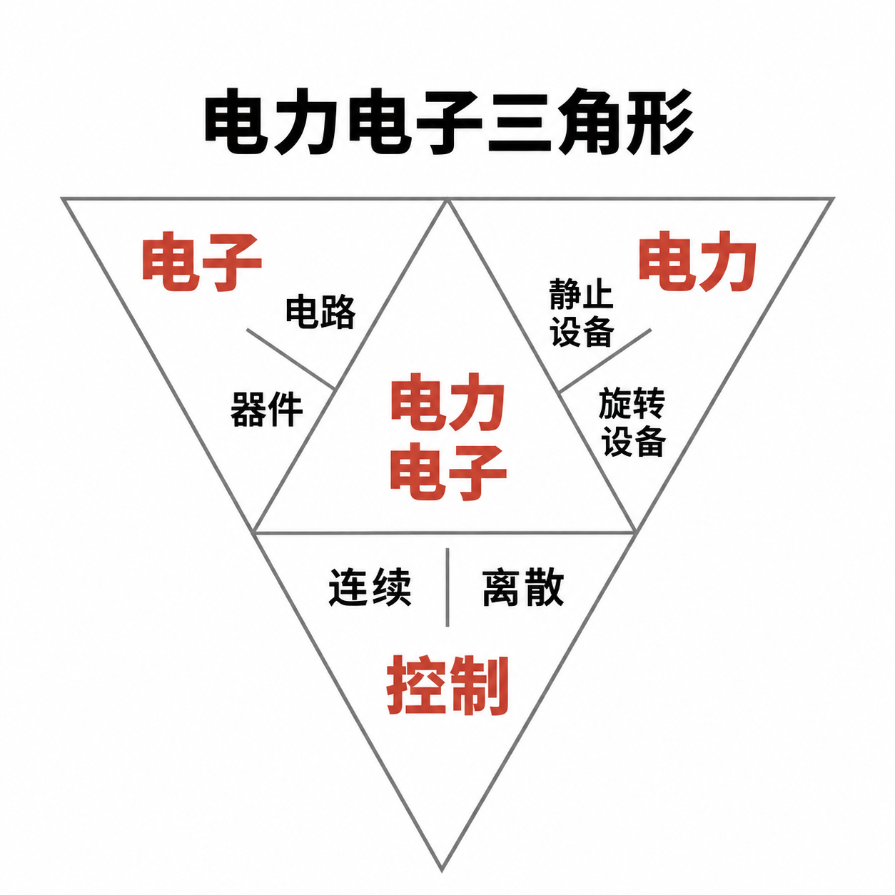
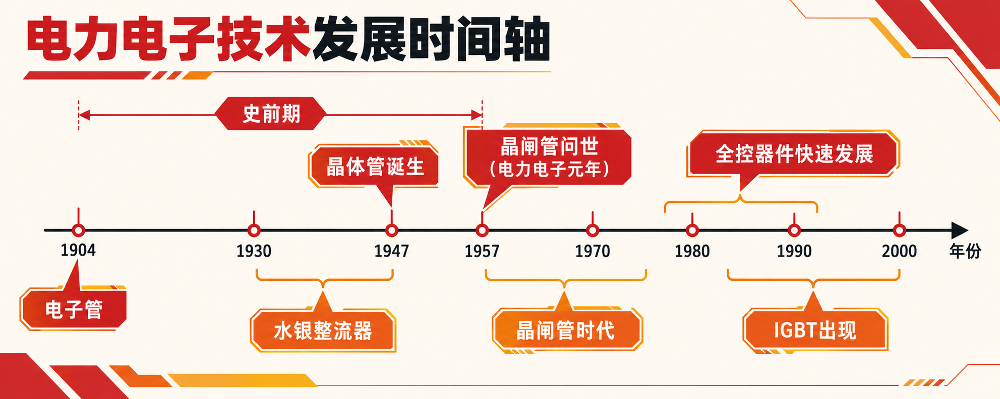
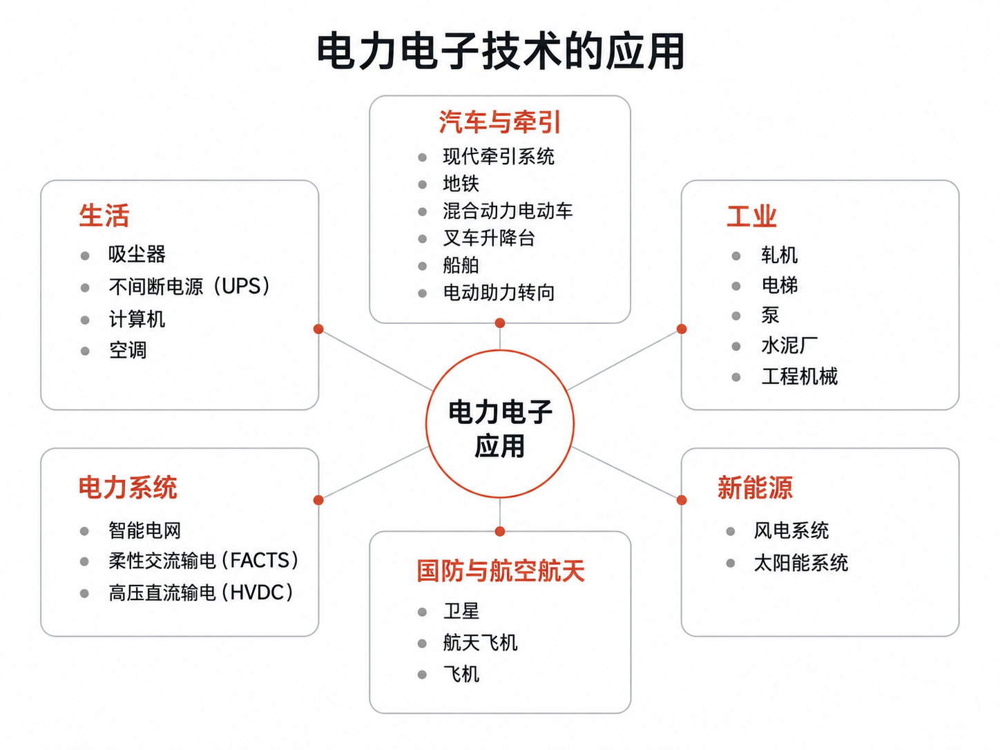

# 综述：电力电子技术

电力电子技术，雷属性天阶功法。此法使用天地间的一种力量，名为电能。它可化作电机轴上的千钧转矩，也可沿输电线路远行千里。但电能自有其形态：交流与直流有别，电压有高低，频率有快慢。而电力电子技术，则是驾驭电能的绝佳之法。

修炼此法，以功率半导体为开关，以电感、电容和变压器调度能量，再以控制理论驾驭整个系统。开关之间，既可升降电压，也可变换交直流，天阶功法恐怖如斯——

然而，入门者常以为，选得一枚强大的功率器件，便能练成此功。待到亲手搭建电路，才发现开关有损耗，走线藏电感，反馈稍有不慎，输出便振荡不止。

欲修此天阶功法，须先认清三大根基：电力、电子、控制。三者相互支撑，构成电力电子修炼心法，三转重元功。此后以此法发展脉络，方能看懂这门功法的来路与门道。

## 一、电力电子是什么？

通俗地讲，电力电子技术就是利用功率半导体器件对电能进行高效变换的技术，包括对电压、电流、频率和波形等的变换，以满足各种不同用电设备的需求。它是综合了电子技术、控制技术和电力技术而发展起来的应用性很强的新兴学科。随着经济技术水平的不断提高，电能的应用已经普及到社会生产和生活的方方面面，现代电力电子技术无论对传统工业的改造还是对高新技术产业的发展都有着至关重要的作用，新型电力电子技术已渗透到科研交通、能源、环保及军工等领域，成为提升各种大功率现代装备综合能力的关键技术，受到各国政府、研究机构、行业和企业的高度重视。毫无疑问，电力电子技术将成为21世纪的重要关键技术之一。

1973年6月，在美国召开的美国电气与电子工程师学会（Institute of Electrical and Electronics Engineers，IEEE）电力电子专家会议上，美国西屋电气公司的William Newell博士作了题为“电力电子——从不被重视到脱颖而出”的主旨报告，该报告在电力电子学科发展历史上具有重要的意义。他首次给出了电力电子技术的定义：“电力电子技术是电气工程三大学科——电子、电力和控制的交叉”，并用倒三角进行了形象的表示。

 

理解这门学科，看“电力电子三角形”是一个常见的入口。其中，电子学科包括器件和电路，电力学科包括静止设备和旋转设备，控制学科包括连续控制和离散控制。因此，电力电子技术是一门多学科交叉技术。

1989年，著名电力电子专家Bimal K. Bose博士又对电力电子技术的内涵进行了扩展和细化，指出电力电子技术是多学科的交叉，这些学科包括功率半导体器件、功率变换电路、控制理论、电机、模拟和数字电路、超大规模集成电路、微机应用和计算机辅助设计等。随着电力电子技术日益广泛的应用，电力电子技术所涉及的学科越来越多，如现代控制理论、微电子技术、材料科学、环境科学、生命科学等，逐步形成一门独立的跨学科的高新技术学科。

### 电力电子主要进行哪些变换？

从输入、输出的电能形式来看，基本变换可以分为四类。

| 变换类型 | 常用名称 | 主要作用 | 应用例子 |
|---|---|---|---|
| 交流变直流，AC/DC | 整流 | 将交流电转换为直流电 | 充电器、直流电源 |
| 直流变交流，DC/AC | 逆变 | 将直流电转换为交流电 | 光伏逆变器、电机驱动逆变器 |
| 直流变直流，DC/DC | 直流变换 | 升高或降低直流电压，也可实现隔离 | 电池供电设备、车载电源 |
| 交流变交流，AC/AC | 交流变换 | 改变交流电压、频率等参数 | 交流调压、变频系统 |

实际设备可能组合多种变换。例如，许多变频器先将交流电整流成直流电，再通过逆变器产生频率和幅值可调的交流电。

## 二、电力电子技术的发展历史

电力电子技术的发展，主要由**功率器件、变换电路和控制技术**共同推动。其中，功率器件的进步为电路与控制方式的创新提供了基础，因此可以沿着器件发展的脉络，将其历史概括为以下几个阶段。

 

### 1. 早期探索：电子管与汞弧整流器时代

在功率半导体器件出现之前，人们已经利用电子管、汞弧整流器等设备实现电能变换。这些设备用于电化学工业、电气铁路、直流电机传动等领域，推动了整流、逆变和交交变频电路的发展，为后来的电力电子技术奠定了基础。

### 2. 晶闸管时代：现代电力电子技术兴起

1957年，通用电气研制出实用的晶闸管，成为现代电力电子技术发展的重要标志。晶闸管凭借较好的电气性能，逐步替代汞弧整流器，并广泛应用于可控整流、工业调速和直流输电等领域。

这一阶段主要采用**相位控制**。普通晶闸管可以通过门极触发导通，却不能通过门极直接关断，属于半控型器件，其应用受到换流条件的限制。

### 3. 全控型器件时代：从相位控制走向脉宽调制

20世纪70年代后期，GTO、功率BJT和功率MOSFET等全控型器件快速发展。它们既能受控导通，也能受控关断，使变换器能够更灵活地安排开关动作。

随着器件开关能力提升，\*\*脉宽调制（PWM）\*\*得到广泛应用，促进了开关电源和交流调速技术的发展，也为提高开关频率、缩小装置体积创造了条件。

### 4. IGBT与模块化发展：拓展中大功率应用

20世纪80年代，IGBT得到发展。它结合了MOS栅极易于驱动和双极型器件较好的导通性能，在中大功率变换中获得广泛应用。

与此同时，功率器件逐渐向模块化发展。多个芯片按照电路结构封装在一起，可以缩短互连、减小寄生电感；进一步结合驱动、检测和保护电路，则形成智能功率模块等产品，提高了装置的紧凑性和集成程度。

### 5. 宽禁带器件时代：追求更高效率与功率密度

进入21世纪，以碳化硅（SiC）和氮化镓（GaN）为代表的宽禁带功率器件逐步发展并走向商业应用，为改善耐压、导通损耗和开关速度之间的关系提供了新的空间。

SiC和GaN推动了高效率、高频率和高功率密度变换器的发展，同时也对驱动、封装、散热及电磁兼容提出了更高要求。

### 6. 贯穿各阶段的进步：软开关与控制技术

在器件不断发展的同时，变换电路和控制方法也持续演进。为了降低高频开关损耗，人们发展了谐振、准谐振及移相控制等技术，在合适条件下实现**零电压开关（ZVS）或零电流开关（ZCS）**。

因此，电力电子的发展并非单纯的器件更替，而是器件、电路和控制相互促进的过程，其设计目标也逐步扩展到效率、体积、动态性能、可靠性和成本的综合优化。

## 三、电力电子技术的应用

电力电子技术的应用，从手机充电器延伸到高压直流输电，覆盖工业生产、交通运输、信息通信和日常生活。不同场景对功率、体积和控制性能的要求各不相同，但核心任务一致：**将电能高效地变换为设备需要的形式，并按要求进行调节。**

  

1. 工业生产：调节动力，服务工艺

电机驱动是电力电子技术的重要应用。通过调节供电电压、电流和频率，电力电子装置能够控制电机的转速与转矩，满足轧钢机、数控机床、矿山牵引等设备的运行要求。对于风机、水泵等负载，变频调速还可以根据实际需求调节出力，减少不必要的能量消耗。

除了电机驱动，工业生产中的电解、电镀需要直流整流电源，金属感应加热、淬火等工艺需要特定频率和功率的加热电源。这些电源也属于电力电子装置。

2. 电力系统：输送电能，改善供电质量

在高压直流输电中，换流站利用电力电子装置完成交流与直流之间的变换，实现电能输送。柔性交流输电装置则通过调节电网参数或注入受控电压、电流，参与电网运行控制。

电力电子技术还用于无功补偿、谐波治理和电压调节。例如，静止无功发生器（SVG）用于动态无功补偿，有源电力滤波器（APF）用于补偿谐波电流，帮助改善电能质量。

3. 电气化交通：驱动运行，管理车载电能

高铁、地铁和轻轨的牵引系统，通过变流器向牵引电机提供可调的电压和电流，实现运行控制；辅助变流器则为照明、空调等车载设备供电。

在电动汽车中，牵引逆变器负责驱动电机，DC/DC变换器连接不同电压等级的供电系统，充电装置负责向动力电池补充电能。电力电子技术贯穿车辆的充电、驱动和辅助供电环节。

此外，飞机的电源变换与电动执行机构，以及船舶的电力推进和综合供电系统，也需要电力电子技术支持。

4. 信息通信：为计算与通信提供稳定电源

计算机、通信设备和服务器内部的电路，需要不同电压等级的稳定直流电。开关电源和DC/DC变换器承担这些电压变换与稳压任务。

对于需要连续运行的设备，不间断电源（UPS）通过储能与电能变换，在市电异常时维持供电。数据中心则需要多级电源系统，将输入电能逐步转换为服务器和芯片所需的电能。各级变换的效率与可靠性，都会影响整个系统的运行。

5. 新能源与储能：连接能源设备和电网

光伏组件产生直流电，需要通过逆变器转换为满足并网要求的交流电。风力发电系统也需要根据发电机形式和运行条件，通过变流装置调节电能输出。

储能系统中的双向变换器，则控制电池与直流母线或电网之间的功率流动，实现充电和放电。电力电子装置由此成为新能源、储能与电网之间的重要接口。

6. 家用电器：让用电设备按需工作

家用电器中的电力电子应用十分常见：LED驱动电源调节照明所需的电流，变频空调和冰箱通过驱动电路调节压缩机运行，洗衣机利用电机控制完成不同洗涤动作，电磁炉则通过高频电能变换实现感应加热。

这些应用将电力电子技术带入日常生活，让设备能够根据使用需求调节输出，并兼顾效率、体积和使用体验。

## 四、电赛中的电力电子技术

电赛里的“电源组”，就和电力电子技术息息相关。题目既可能要求制作一个稳压电源，也可能涉及逆变、无线充电、多电源并联、功率因数校正和能量回馈。

对刚入门的同学来说，可以先通过历年题目认识这个方向，再了解一套装置由哪些模块组成。

### 1. 历年国赛中的典型电源题

下表选取部分有代表性的赛题。“考查内容”是根据题目任务作的入门归纳，具体指标以原题为准。

| 年份 | 题号 | 赛题名称 | 主要考查内容 |
|---|---|---|---|
| 2007 | E | [开关稳压电源](https://nuedc.org/problems/2007_E题_开关稳压电源.pdf) | 直流升压、输出电压调节、纹波、效率、过流保护 |
| 2009 | A | [光伏并网发电模拟装置](https://nuedc.org/problems/2009_A题_光伏并网发电模拟装置.pdf) | 直流变交流、最大功率点跟踪（MPPT）、频率与相位跟踪、波形失真 |
| 2011 | A | [开关电源模块并联供电系统](https://nuedc.org/problems/2011_A题_开关电源模块并联供电系统.pdf) | 两个DC/DC模块并联、输出稳压、按比例分配电流、效率 |
| 2013 | A | [单相AC-DC变换电路](https://nuedc.org/problems/2013_A题_单相AC-DC变换电路.pdf) | 交流变直流、稳压、功率因数测量与校正、效率和保护 |
| 2015 | A | [双向DC-DC变换器](https://nuedc.org/problems/2015_A题_双向DC-DC变换器.pdf) | 电池恒流充电、放电稳压、能量双向流动、模式自动切换 |
| 2017 | A | [微电网模拟系统](https://nuedc.org/problems/2017_A题_微电网模拟系统.pdf) | 三相逆变、交流母线稳压、多逆变器协调运行 |
| 2019 | A | [电动小车动态无线充电系统](https://nuedc.org/problems/2019_A题_电动小车动态无线充电系统.pdf) | 无线电能传输、超级电容储能、能量利用，以及小车循迹控制 |
| 2021 | B | [三相AC-DC变换电路](https://res.nuedc-training.com.cn/topic/2021/topic_32.html) | 三相整流、输出稳压、功率因数调节与效率 |
| 2021 | C | [三端口DC-DC变换器](https://nuedc.org/problems/2021_C题_三端口DC-DC变换器.pdf) | 模拟光伏、电池和负载之间的能量分配、MPPT、充放电切换 |
| 2023 | A | [单相逆变器并联运行系统](https://res.nuedc-training.com.cn/topic/2023/topic_95.html) | 单相逆变、同步、并联电流分配及并网运行 |
| 2025 | A | [能量回馈的变流器负载试验装置](https://nuedc.org/problems/2025_A题_能量回馈的变流器负载试验装置.pdf) | 三相逆变、交流侧能量回收、直流侧回馈及变流器协调控制 |
| 2025 | B | [单相有源电力滤波实验装置](https://nuedc.org/problems/2025_B题_单相有源电力滤波实验装置.pdf) | 电压电流采样、谐波分析、补偿电流控制和有源滤波 |

从这些题目可以看出，电源方向的任务逐步覆盖了单台变换器、多端口能量管理和多机协调。基础的升压、降压和逆变电路，会在不同系统中反复出现。

### 2. 省赛及赛区赛中的典型电源题

省赛题目可能因赛区而异，同一年的题号不一定对应同一道题。因此，查找资料时应同时核对年份、赛区和赛事名称。

| 年份 | 赛事归属 | 题号与题目 | 主要考查内容 |
|---|---|---|---|
| 2016 | 湖南省赛 | [A题：单相正弦波逆变电源](https://hnedc.hnie.edu.cn/__local/D/C9/27/A5E94FFFF91DCAF5CC41C7BB211_1D29FFC7_50800.pdf) | 直流变交流、正弦波输出、稳压、效率及保护 |
| 2018 | TI杯省赛参考题 | [E题：变流器负载试验中的能量回馈装置](https://www.nuedc-training.com.cn/index/news/details/new_id/57.html) | 单相逆变、整流回馈、交流电流控制及能量循环利用 |
| 2020 | TI杯省赛 | [B题：单相在线式不间断电源](https://www.nuedc-training.com.cn/index/news/details/new_id/223) | 交流与直流供电、正弦波逆变、供电切换、稳压与效率 |
| 2022 | TI杯省级联赛7月参考题 | [A题：单相交流电子负载](https://res.nuedc-training.com.cn/topic/2022/topic_57.html) | 模拟电阻、电感和电容负载，控制电流幅值与相位，实现能量回馈 |
| 2024 | 赛区赛暨模拟电子系统设计专题赛初赛 | [A题：AC-AC变换电路并联运行](https://res.nuedc-training.com.cn/topic/2024/topic_109.html) | 交流直接变换、输出调压、并联电流分配、效率与波形质量 | 
| 2026 | 赛区赛暨TI杯模拟电子系统设计专题赛初赛 | [A题：AC-AC变换电路](https://res.nuedc-training.com.cn/topic/2026/topic_133.html) | 单相交流输入变为三相交流输出、输出电压与频率调节、输入功率因数、波形失真、稳压性能及变换效率 |

### 3. 常用的模块

一套电源装置，可以拆成几个相互配合的部分。这里的“模块”既可以是一块独立电路板，也可以是同一块PCB上的一个功能区域。

| 模块 | 通俗理解 | 主要作用 |
|---|---|---|
| **主控模块** | 负责计算和发指令 | 读取采样值、运行控制程序、产生PWM、管理工作模式 |
| **辅助电源模块** | 给控制电路供电 | 为主控、运放和驱动器提供合适的供电电压 |
| **驱动以及桥模块** | 把控制信号变成功率器件需要的信号 | 驱动MOS管等器件导通、关断，部分场合还需要隔离 |
| **功率模块** | 真正承担电能变换 | 由功率器件、电感、电容等组成降压、升压或桥式变换电路 |
| **电压采样模块** | 测量电压 | 将被测电压缩放、滤波或隔离后送入ADC |
| **电流采样模块** | 测量电流 | 为恒流控制、均流、功率计算和过流保护提供反馈 |
| **显示与操作模块** | 设置参数、查看状态 | 使用按键、编码器或显示屏设置目标值，显示测量值与故障信息 |

这些模块里，**辅助电源、驱动和采样**值得尽早练习。它们会在不同题目中反复使用，也经常影响整套系统能否稳定工作。

例如，采样存在偏差，控制器就会根据错误的测量值调节输出；驱动波形不好，即使PWM程序正确，功率器件也可能无法正常开关。

### 4. 不同题目需要增加的功能

通用模块打好基础后，再根据题目选择功率电路和专用功能。下面是常见实现思路，并非每道题唯一的方案。

| 题目方向 | 通常需要的功率电路或专用功能 |
|---|---|
| 降压、升压电源 | Buck或Boost功率电路、储能电感、输出滤波 |
| 双向DC/DC | 支持双向电流的功率电路、双向电流采样、充放电模式管理 |
| 单相逆变器 | 常见为全桥功率电路、输出滤波、交流电压与电流采样、正弦调制 |
| 三相变换器 | 三相桥式功率电路、多路驱动与采样、三相调制 |
| 并联供电 | 每台变换器独立的电流反馈，以及同步、均流或功率分配功能 |
| 无线充电 | 高频功率电路、谐振补偿网络、发射与接收线圈、接收端整流及储能 |
| 有源滤波与交流电子负载 | 可控桥式电路、电流跟踪、同步与谐波处理；回馈任务还需相应能量通路 |

备赛时，可以先搭建一套低压、小功率的降压电源，把**供电、驱动、采样、闭环和保护**完整调通，再逐步练习双向变换、逆变和并联。

提前准备模块的价值，在于熟悉电路、接口和调试方法。实际比赛中，模块能否使用、是否允许成品方案，以及主控和辅助供电的限制，都应以当届赛题要求为准。
